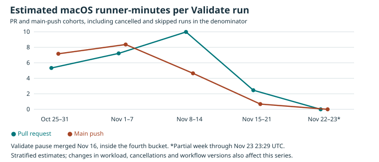

# Faster feedback on Clubhouse desktop changes

**Keep the full checks authoritative.** The strongest immediate opportunity is to surface the first actionable Linux or Windows failure while its job finishes. In 42 sampled failed jobs with an identifiable test report, the median interval from that report to job completion was **5m 34s**. The test-selection experiment found **zero eligible historical runs** in the ordinary-event sample. There is no measured evidence for dropping a required check today.

A follow-up audit measured which composer tests detect visible text and formatting regressions. [Prompt-codec test value, leave-one-group-out results and historical bug replay](behavior-value/REPORT.md)

## What a PR or main push costs

The run-created window spans October 25 00:00 through November 23 23:29 UTC, 2026. It covers 2,343 runs. Validate accounted for 2,254, with 1,294 successes, 317 failures, 631 cancellations and 12 skips at observation. Of these, 177 runs had multiple attempts, producing 2,485 attempts in total. The job sample comprises 181 runs across 93 strata. It includes 12 runs with no observed jobs. Deduplication removed 37 attempt records that repeated prior work under new job IDs. The ordinary comparison covers 1,527 PR runs and 694 main pushes, sampled at 47 and 42 respectively. Historical full-ci labels were unavailable. [Sampling and reproduction](history-methods.md)

| Estimated ordinary Validate metric | PR | Main push |
|---|---:|---:|
| Linux + Windows unit/build/E2E runner-minutes per run | 85.3 ± 4.0 | 60.9 ± 3.7 |
| Of those, Windows runner-minutes | 49.7 ± 2.5 | 35.3 ± 2.2 |
| macOS runner-minutes per run over the whole period | 7.5 ± 2.3 | 5.0 ± 1.5 |
| First failed job complete, minutes after run creation | 9.6 ± 0.9 | 15.4 ± 2.3 |
| Observed successful portable checks complete, minutes after run creation | 13.2 ± 0.6 | 15.5 ± 1.0 |

Uncertainty is one approximate design standard error. Runner-minutes add simultaneous jobs. Feedback times measure wall time for runs where the endpoint was observed. The portable success endpoint requires substantial successful unit work on **both** platforms and successful completion of the latest visible applicable jobs. Sixteen sampled runs in each event met it. The data cannot establish billing, exact runner provisioning time, or a flake rate from reruns. [Phase and timing tables](history-ordinary.md) · [Full history](history-findings.md)



Before the November 16 date split, estimates were 9.0 macOS minutes/PR and 6.0/main push. The post-split sample observed zero macOS execution in 14 PRs and 14 pushes. The November 16 pause removed ordinary automatic macOS work at the inspected baseline, so extending the pause saves **zero additional ordinary PR macOS minutes**. Across all Validate events in the window, macOS unit work accounted for an estimated 205.5 hours, build and E2E smoke for 49.4. The historical PR-only Mac estimate is 191 hours and main pushes account for about 58 hours. Changes in traffic, failures and job mix limit before/after comparisons. [Pause PR](https://github.com/Agent-Clubhouse/Clubhouse/pull/3570) · [Underlying estimates](data/history-validate-estimates.csv)

## What determines feedback time

On the November 23 main push at the study baseline, planning finished at 23:00:11 UTC. The Linux build finished at 23:05:28 and Windows at 23:06:44. Linux E2E jobs waited for the combined build matrix and started at 23:06:46. The last E2E job finished at 23:12:56. The Windows unit shard had already reported a failing ledger test at 23:07:54, but the shard and run finished at 23:21:19. An earlier Linux E2E start could have reclaimed about 76 seconds of dependency wait on that branch of the graph. It would have saved **zero** on this run's completion time. Reporting the observed Windows failure promptly offered roughly **13m 24s** of earlier diagnostic feedback. It would still require the entire shard to run. [Actual run](https://github.com/Agent-Clubhouse/Clubhouse/actions/runs/45284846388) · [Job timelines](data/history-jobs.csv) · [Failure timestamps](data/replay-failures.csv)

Across the wider sample, median/p90 macOS job creation-to-start lag was 3s/754s. These timestamps combine dependency waits, scheduling, approval and setup where applicable. They cannot isolate a queue-capacity bottleneck. Existing PR concurrency already cancels superseded runs. Cancelled job execution averaged 75s on Linux, 233s on Windows and 185s on macOS per historical PR, with considerable uncertainty. Cancellation alone cannot distinguish a superseded head from a user cancellation or prove that all those seconds are avoidable. [Delay and cancellation tables](data/history-phases.csv)

## Which tests can change together?

The selector reads both Git trees and enforces an AST contract on a single production candidate, the renderer duration formatter. It permits local numeric/string logic and rejects new dependencies, effects, signature changes and unsupported syntax. Edits to three existing test files qualify only under narrow assertion-literal contracts. Shared/public interfaces, IPC/preload, native and build modules, dependencies, workflow/configuration, fixtures, unknown paths or missing history revert to the full suite. Each report records input revisions, project/file identities, parser and contract fingerprints, reasons and invariant checks. [Implementation contract](selector-contract.md) · [Architecture-to-test map](architecture-map.md)

A single formatter importer reaches TranscriptViewer, application shells and plugin roots. Filesystem-based copy, namespace, CSS and bridge tests also escape an import-only graph. A synthetic rounding edit retained **1,468 of 1,491** test files on the baseline. Retaining renderer, shared, preload, integration and identified main consumers on both Linux and Windows preserves separate filesystem, process and runtime observations. Portable checks cannot establish native macOS execution. Existing build, E2E, artifact and native gates keep their current triggers. File counts provide no runtime estimate.

## Historical replay and fault evidence

We replayed 89 sampled ordinary events. Planner logs identified 42 PR base/head pairs and 30 main push before/head pairs. PR comparisons use the unique merge base. They establish the changed source tree, independently of any synthetic merge checkout used by CI. All 72 recovered diffs required full coverage. The other 17 lacked a successful plan and also defaulted to full. **No historical run qualified for pruning.** The retrospective therefore establishes neither a selected-run false-negative rate nor a runner-minute reduction. [Event receipts](data/replay-context.csv) · [Replay decisions](data/selector-replay.csv)

Reporter logs identified 46 distinct run/failing-file pairs. Restricting tests to the exact directories of edited files would have excluded **23 of those 46 pairs across 19 runs**, counting file identities once per run across platforms. The comparison includes unit and E2E files. It tests the directory heuristic, without attributing the failure to the change. Eighteen of 60 failed-job observations had no identifiable file. They remain unknown. The median 334s reporter-to-completion interval above is unweighted across the 42 identifiable jobs, using the first recognized failure line in each and UTC timestamps truncated to seconds. Remote logs can expire. [Extracted evidence](data/replay-failures.csv) · [Replay code](replay.py)

| Local bounded experiment | Result | Decision |
|---|---|---|
| Eight witnessed changes to the existing CI classifier | Original suite missed mixed docs + source. One expectation caught it. Strict rerun killed 8/8, with no invalid or unresolved mutants. | Keep the expectation. Run the 27-test classifier suite for changes to this classifier. Sixteen targeted processes took 4.941s versus 5.106s for the full classifier-file strategy. |
| Three formatter faults under the normal renderer configuration | Direct tests detected 3/3. TranscriptViewer detected the suffix error and missed rounding and minute-boundary faults. Both original suites passed 14/14 before and after. | Retain both behavioral layers. This two-file witness took 6.522s on the Mini. It does not measure the full proposed selection or native Windows/Linux behavior. |

The classifier trial used two repetitions per strategy, ten original green controls and a bounded set of 32 mutant processes. Runtime, setup and mixed failures cannot count as assertion kills under the reviewed verdict. These purpose-built probes are suitable for local use after changing a classifier or boundary. Escalate to scheduled differential checks only where the wider fault set warrants the spend. [Classifier pilot and receipts](mutation-pilot.md) · [Formatter witnesses and reproduction](formatter-sensitivity.md)

## Priorities and conditions for changing CI

1. **Surface actionable failures before job completion.** Prototype a bounded file/test-name annotation or summary from the existing reporter on each OS. Keep the final check authoritative and allow remaining assertions and teardown to finish. Compare the first useful diagnostic to today's live logs and job completion on the same run. The 334s median measures the available reporting interval. Users already watching logs may see no improvement.
2. **Use the selector in shadow, starting with ordering.** Prioritize affected tests within existing shards before proposing omissions. Linux and Windows unit shards together account for 26.6 runner-minutes per PR and 19.7 per main push. These are the addressable job envelopes. Current replay supports zero bankable minutes. The first architecture investment is an explicit manifest for filesystem-reading tests and enforced separation between pure presentation logic and plugin/UI roots. Expand a cohort only when real changes exercise it. Compare full and proposed per-test identities, failures, status and wall time on the same head separately on both OSes.
3. **If ordinary macOS validation resumes, deduplicate fixed and related tests by resolved project/file identity.** The fixed filters match 63 files. On historical PRs the fixed and related steps accounted for 32s and 172s respectively per census run. Even perfect overlap can remove only duplicated execution, not both phases. Four cancelled Mac jobs lack all step timings, leaving 158s/PR unattributed. Measure overlap and timings on opted-in runs before proposing savings. Keep real Darwin update-script execution, packaging and native checks under their intended triggers. A mocked keychain, watcher or Windows updater cannot replace them. [Workflow archaeology](workflow-plan.md)
4. **Measure per-OS build readiness and reuse.** Existing E2E already reuses one build per OS. Investigate per-OS dependency wiring only where a slower independent build actually delays actionable feedback. Keep OS/architecture, lockfile, Electron/Node and packaging/configuration inputs in cache keys. Share no executable build artifacts across OS, trust boundary or signing context. An early cheap check can order work, but canceling or gating a matrix on its failure can hide independent failures. Record those coverage and fairness effects first.

**Promotion rule.** Preserve full baseline checks during shadow collection. Record the precise push/PR comparison, executed checkout, graph/config hashes, platforms, proposed test identities and actual baseline outcomes. An omitted failure, unexplained edge, changed input, cancellation, skip or missing OS receipt supplies no evidence for promotion. Require a separate reviewed policy change with Linux and Windows differential execution, real eligible historical or prospective changes, measured net feedback improvement, and relevant native coverage. Roll back any future routing rule to full fan-out if its identity or evidence is missing. There is no workflow edit in this branch.

## Reproduce the investigation

The [history methodology](history-methods.md) describes pagination, sample weights and retention. The committed tables support offline analysis. Rebuilding original step-level estimates uses the preserved private API cache. Regenerating event contexts and failure timestamps uses read-only GitHub job logs and may return fewer rows after retention expires. The selector reads historical blobs without executing them. From a checkout with the repository dependencies already present:

```sh
python3 docs/ci-efficiency/replay.py --fetch-missing
node docs/ci-efficiency/charts.mjs
node scripts/ci/affected-shadow.mjs --base <before-commit> --head <head-commit>
```

The release data and phase notes collected before the scope correction are available as an [appendix](release-jobs.csv). They do not enter the ordinary-push recommendations.
